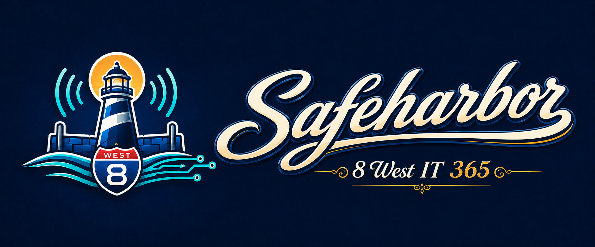

  

# Safeharbor

**Every client issue, safely ashore.** Safeharbor is the help desk for
[8 West IT 365](https://8westit.com/), built by 8 West IT, LLC. Technicians manage client requests,
conversations, service goals, approved time and reports. It works with Milepost for device and alert
context, Coastmark for draft invoice lines, and 8 West ID for sign-in.

Live at [safeharbor.8westit.com](https://safeharbor.8westit.com/) for authorized accounts; it is not a
public demo. What is switched on: [docs/where-things-stand.md](docs/where-things-stand.md).

## What it does

- **Support requests:** technician queue, conversations, internal notes, saved replies, attachments,
  search and customer feedback. Milepost alerts and partner apps can open scoped tickets.
- **Service and work:** versioned first-response goals, technician time with human approval and
  correction slips, operational and scheduled business reports.
- **Customers:** a portal for new requests, replies, ticket details and report archives, with private
  Westy chat, device enrollment and computer checks for enabled customers.
- **Suite:** approved time can become a *draft* invoice line in Coastmark; Coastmark owns pricing and
  every later invoice step. Westy advises; it never approves time or sends invoices.

## Repository

| Path | What |
|---|---|
| [app/](app/) | The PHP application ([app guide](app/README.md)) |
| [brand/](brand/) | Logos and the [brand guide](brand/README.md) |
| [docs/](docs/) | What is live, and the contracts other apps rely on |
| [deploy/](deploy/) | The [deploy runbook](deploy/README.md): one script, with a backup and automatic undo |

PHP 8.3, MySQL, Apache and plain JavaScript, with no build step. Contributors and agents start with
[AGENTS.md](AGENTS.md).
